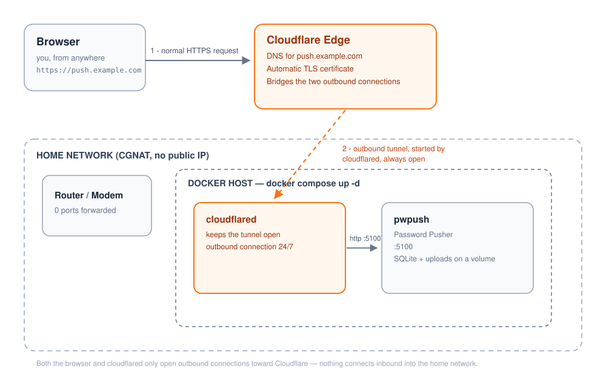

# Password Pusher Stack (Cloudflare Tunnel)

A self-hosted deployment of [Password Pusher](https://pwpush.com)
([pglombardo/PasswordPusher](https://github.com/pglombardo/PasswordPusher)),
the open-source tool for sharing a secret through a one-time link that
expires by time or view count, instead of pasting it into chat or email.
This stack runs your own private instance, reachable from the internet
without opening a single port on your router, even behind CGNAT
(carrier-grade NAT, common on home internet connections with no public IP).


## Why self-host it

The public instance at pwpush.com works fine for most people, but a private
instance means your pushes never touch a third party's database, you set
your own retention and expiry defaults, and you control the encryption key.
It also pairs with
[HidePWPushPassword](https://github.com/juliomauro/HidePWPushPassword), a
small CLI wrapper for pushing passwords from the terminal, which already
supports pointing at a self-hosted instance with its `-u` flag.

## Why this works behind CGNAT



Both your browser and the `cloudflared` container only ever open
**outbound** connections toward Cloudflare. Nothing connects inbound into
your home network, so no port forwarding, no dynamic DNS client, and no
public IP are required.

## Stack

| Service | Role |
|---|---|
| `cloudflared` | Keeps an outbound tunnel open to Cloudflare, routes traffic to `pwpush` |
| `pwpush` | Password Pusher itself, with its built-in SQLite database |

No separate database container. Password Pusher stores everything in a
SQLite file on a single persistent volume, which keeps this stack to two
services.

## Prerequisites

- A domain (or subdomain) added to a Cloudflare account, with Cloudflare as
  the DNS provider. A subdomain of a domain you already manage on
  Cloudflare works fine, you do not need a separate domain.
- Docker and Docker Compose on the machine that will run the stack.
- No router configuration needed. This is the entire point of the tunnel.

## 1. Create the Cloudflare Tunnel

1. Log in to the [Cloudflare dashboard](https://dash.cloudflare.com).
2. Go to **Zero Trust** (sometimes labeled **Networks** or
   **Networking**), then **Tunnels** (on newer dashboards this may be
   under **Networking → Connectors**). Cloudflare renames this section
   from time to time, if you don't see it exactly like this, look for
   "Tunnels" in the sidebar.
3. Click **Create a tunnel**, choose **Cloudflared** as the connector
   type, and give it a name (for example `pwpush-home`).
4. On the install step, select **Docker** as the environment. Cloudflare
   shows a `docker run` command containing a long token starting with
   `eyJ`. Copy just the token value, everything after `--token`. That
   token is this project's `CLOUDFLARE_TUNNEL_TOKEN`.
5. Still in the tunnel setup, go to **Public Hostname** and add one:
   - Subdomain: whatever you want (for example `push`)
   - Domain: pick your domain from the dropdown
   - Service: type `HTTP`, address `pwpush:5100` (the service name and
     port from `docker-compose.yml`, not `localhost`, since `cloudflared`
     reaches `pwpush` over the internal Docker network)
   - Save. Cloudflare creates the DNS record for you automatically, there
     is nothing to add manually in DNS.
6. The token is tied to this one tunnel. If you delete the tunnel later,
   the token stops working and you'll need a new one.

## 2. Configure the stack

```bash
git clone https://github.com/juliomauro/pwpush-stack-cloudflare.git
cd pwpush-stack-cloudflare
cp .env.example .env
```

Generate two keys before starting the stack for real:

```bash
docker compose run --rm pwpush bin/pwpush secret
docker compose run --rm pwpush bundle exec rails secret
```

Edit `.env`:

| Variable | What to put |
|---|---|
| `CLOUDFLARE_TUNNEL_TOKEN` | The token you copied in step 1 |
| `PWPUSH_DOMAIN` | The full hostname you set up in step 1, for example `push.example.com` |
| `PWPUSH_MASTER_KEY` | The key the first command above printed |
| `PWPUSH_SECRET_KEY_BASE` | The key the second command above printed |

`PWPUSH_MASTER_KEY` encrypts every push in the database. If you lose it,
existing pushes become unreadable, and if you change it later without
migrating, the same thing happens. `PWPUSH_SECRET_KEY_BASE` signs login
sessions, without a fixed value every container restart logs everyone out.
Keep copies of both somewhere safe, outside this repo. Never commit `.env`,
it holds real secrets, `.gitignore` already excludes it.

## 3. Start it

```bash
docker compose up -d
```

Open `https://<PWPUSH_DOMAIN>` (the hostname from step 1) in a browser.
Anonymous pushes are enabled by default, no account needed to create one.

Local LAN access is also available on port `5100`
(`http://<host-ip>:5100`) if you want a fallback that does not depend on
Cloudflare being reachable. Remove that port mapping in
`docker-compose.yml` if you do not want it exposed on your LAN.

## Using it from the command line

[HidePWPushPassword](https://github.com/juliomauro/HidePWPushPassword)
talks to any Password Pusher instance, including this one:

```bash
echo 'my secret' | ./HidePWPushPassword.sh -u https://push.example.com -d 3 -v 1
```

## Updating

```bash
docker compose pull
docker compose up -d
```

## Backups

Everything Password Pusher stores (the SQLite database and any uploaded
files) lives on the `pwpush_storage` volume.

```bash
# copy the whole storage directory out of a running container
docker run --rm -v pwpush-stack-cloudflare_pwpush_storage:/data -v "$(pwd)":/backup alpine \
  tar czf /backup/pwpush-storage.tar.gz -C /data .
```

(Volume names are prefixed with the Compose project name, which defaults to
the folder name. Run `docker volume ls` to confirm the exact name on your
machine.) Also keep a copy of `.env`, specifically `PWPUSH_MASTER_KEY`,
somewhere safe, a storage backup is unreadable without it.

## Troubleshooting

- **Tunnel shows as down in the Cloudflare dashboard**: check
  `docker compose logs cloudflared`. A wrong or expired token is the most
  common cause, generate a fresh one from the tunnel's connector page.
- **502 or "Bad Gateway" through the tunnel**: make sure the Public
  Hostname service address is `pwpush:5100`, not `localhost:5100` or an
  IP address. `cloudflared` resolves `pwpush` through Docker's internal
  network, not the host's.
- **Links in the app point to the wrong domain**: confirm
  `PWPUSH_DOMAIN` in `.env` matches exactly the hostname you configured in
  the tunnel, then `docker compose up -d` again.
- **Running on Apple Silicon, a Raspberry Pi, or another ARM machine**: the
  upstream image is published for `linux/amd64`. Remove the
  `platform: linux/amd64` line in `docker-compose.yml` and Docker will
  attempt to run it under emulation, which works but is slower; check the
  [PasswordPusher repo](https://github.com/pglombardo/PasswordPusher) for
  current ARM image availability before assuming emulation is required.

## License

This repository (the compose file, the diagram, this README) is MIT, see
[LICENSE](LICENSE). Password Pusher itself has its own license, see the
[upstream repository](https://github.com/pglombardo/PasswordPusher).
